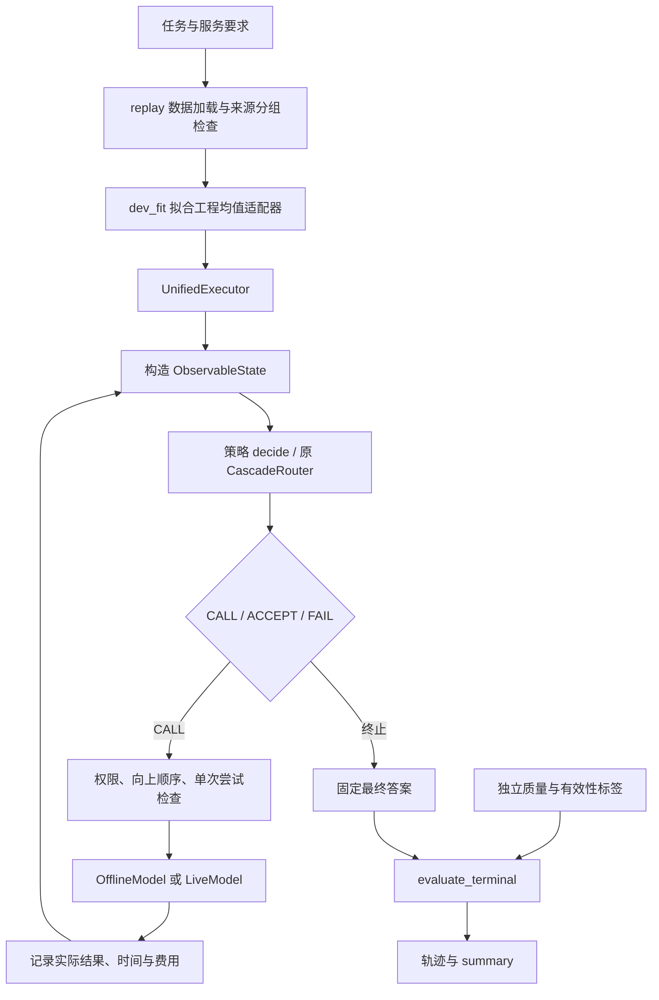

# Cascade Routing：论文与本地代码框架解读

日期：2026-10-12。范围：阅读原 Cascade Routing 论文及本地算法、估计器、实验入口、船岸云适配、统一执行与采集评分代码，并执行已有测试和小规模合成演示。未修改算法源码，未调用真实模型，未运行大型实验。

## 1. 先看清仓库的两层职责

本地项目包含原论文的通用算法库，以及后来增加的船岸云研究工程框架。理解它的关键是分清：**估计器预测各模型的质量与成本，选择算法决定下一步调用或停止，执行器负责实际动作和记账，评估器在终止后判定服务是否成功。**

| 层 | 主要文件 | 解决的问题 |
|---|---|---|
| 通用接口 | `base_algorithm.py`、`base_computer.py` | 统一选择算法和估计器的调用形式 |
| 原论文决策核心 | `router.py`、`baseline_cascader.py`、`cascade_router.py` | 一次路由、阈值级联、超模型级联路由 |
| 质量与成本估计 | `quality_computer.py`、`cost_computer.py`、任务专用估计器 | 根据问题和已返回答案预测质量、成本及不确定性 |
| 超模型统计与参数搜索 | `statistics.py`、`lambda_strategy.py` | 估计集合最优答案质量，选择质量—成本折中参数 |
| 原实验组织 | `scripts/`、`utils.py`、`notebooks/` | 数据转换、拟合、缓存回放、预算扫描、曲线汇总 |
| 本地数据与状态接口 | `schema.py`、`replay_data.py` | 定义在线可见状态与独立评估数据，检查来源分组和缺失值 |
| 船岸云策略适配 | `cascade_adapter.py`、`policies.py` | 将原核心接入受限动作协议及统一执行器 |
| 执行与终局评价 | `executor.py`、`metrics.py` | 动作守卫、时间费用累计、失败并集、未知结果 |
| 小规模离线入口 | `replay.py` | 拟合开发均值，运行五种策略，输出轨迹与汇总 |
| 单条采集和评分 | `single_task.py`、`live_backend.py`、`http_once_worker.py` | 单次 HTTP、持久化尝试账本、双人评分与独立评价 |

这里的文件名都位于 `src/selection/`，特殊目录除外。角色为 ship／shore／cloud 的模型名称，不等于已经配置了相应 Qwen 权重或真实部署设备。

## 2. 原论文的核心：在“模型集合”之间做路由

论文为 Jasper Dekoninck、Maximilian Baader、Martin Vechev 的 *A Unified Approach to Routing and Cascading for LLMs*，ICML 2025，PMLR 267:12987–13010。[官方页面](https://proceedings.mlr.press/v267/dekoninck25a.html)。已将官方 PDF 下载到 [本目录](cascade_routing_icml2025.pdf)，并提取为 [文本](cascade_routing_icml2025.txt)。本次重点阅读 §§2–4 的决策定义、Algorithm 1–3、§5 和附录 D 的估计器设计，并与代码对应；不声称完成附录所有证明的独立数学验证。

### 2.1 Routing：一次选一个模型

对输入问题 \(x\)，估计各模型质量 \(\hat q_i(x)\) 与成本 \(\hat c_i(x)\)，比较：

\[
\tau_i(x)=\hat q_i(x)-\lambda\hat c_i(x).
\]

`Router._predict_model()` 选择该值最大的模型。\(\lambda\) 越大，越重视成本。论文约束的是请求分布上的**平均成本预算**，不是每请求必不超预算。对应：论文 §2、Algorithm 1；[router.py](../../src/selection/router.py:93)。

### 2.2 Cascading：固定顺序中的停止或继续

普通阈值级联依次运行模型，在当前答案的质量预测足够高时停止。`BaselineCascader` 对应这种 thresholding baseline：第一步固定第一个模型，后续比较当前模型质量与 `1 - lambda_`，最终选择已运行序列中最后一个模型。

论文还提出更强的固定顺序级联：比较继续到不同后续位置的集合价值，而不只看当前答案门槛。它在代码中由 `CascadeRouter(cascade=True)` 实现，枚举固定前缀并强制紧邻继续。两者都属于 cascading，但决策机制不同。对应：论文 §3、Algorithm 2；[baseline_cascader.py](../../src/selection/baseline_cascader.py:36)、[cascade_router.py](../../src/selection/cascade_router.py:161)。

### 2.3 Cascade Routing：允许初始选模、跳过模型和答案后再选

原方法把一组候选模型称为 supermodel，可译为“超模型”。**它是一个模型集合及其答案选择规则，不是把权重合并成新模型，也不做答案文本融合。**

对集合 \(S\)，论文估计：

\[
\hat q_S=\mathbb E[\max_{i\in S}\tilde q_i],\qquad
\hat c_S=\sum_{i\in S}\hat c_i,\qquad
\tau_S=\hat q_S-\lambda_j\hat c_S.
\]

\(\tilde q\) 表示估计不确定性下的质量量。当前已经调用的模型集合为 \(H\)，则比较的集合须包含 \(H\)。如果最优集合没有新增模型，就停止；如果包含尚未运行的模型，就执行一个新增模型，再用实际回答更新估计。

三个模型初始最多有七个非空集合：`{ship}`、`{shore}`、`{cloud}`、`{ship,shore}`、`{ship,cloud}`、`{shore,cloud}`、`{ship,shore,cloud}`。已调用船端后，只比较包含船端的集合。开启向上顺序约束后，一旦跳过某低层模型，之后不能再回头调用它。

对应：论文 §4、Algorithm 3；[cascade_router.py](../../src/selection/cascade_router.py:87)。理论上的一般框架允许更灵活的模型序列，论文也给出先运行一个模型、再运行另一个较小模型的例子；本地船岸云协议明确限制严格向上，两者的动作空间不同。

原文的最优性结论针对其定义的估计目标、成本约束和相应假设，不意味着预测器一定正确、真实服务绝对最优或具有服务失败概率保证。

## 3. 原代码的接口与数据流

### 3.1 三个数据数组

以 N 条问题、M 个模型为例：

```python
questions       # 长度 N，元素可为字符串或任务专用表示
model_answers   # N × M，未调用位置为 None
qualities       # N × M，估计器输出各模型的预测质量
costs           # N × M，估计器输出各模型的预测成本
sigma           # 每问题一个 M × M 协方差矩阵，或 None
```

`model_answers` 是最重要的信息边界。例如 `[ship_answer, None, None]` 只暴露船端回答，岸端和云端仍不可见。已有回答既用于评价该答案，也可以为未调用模型的预测提供反馈。

这些不是原始质量标签矩阵。训练或评估使用的 `ground_truth_qualities` 与在线预测值分开。原实验中的特殊 GroundTruth 估计器是噪声诊断设定，不应直接迁入真实路由器作为可观测输入。

### 3.2 两类 fit 的职责不同

```python
quality_computer.fit(estimator_questions, all_answers, quality_labels)
cost_computer.fit(estimator_questions, all_answers, observed_costs)

router = CascadeRouter(quality_computer, cost_computer, models,
                       max_expected_cost=target_budget)
router.fit(tuning_questions, tuning_answers,
           ground_truth_qualities=tuning_labels,
           ground_truth_costs=tuning_costs)
```

前两次 `fit` 学习预测器；`CascadeRouter.fit()` 调整各阶段 \(\lambda_j\) 和并列最优方案的混合参数 \(\gamma\)。**路由器的 fit 不会自动替你训练质量估计器。** `trigger_training(True)` 主要改变估计器的缓存／运行模式，也不等价于拟合预测器。[utils.py](../../src/selection/utils.py:405)、[cascade_router.py](../../src/selection/cascade_router.py:196)。

原实验一般把训练数据前段用于估计器，后段用于策略参数搜索；RouterBench 的 GroundTruth 噪声实验另有特殊路径。这个“参数拟合”不应与船岸云论文中的独立失败风险校准混为一谈。

### 3.3 在线循环由调用方完成

```python
answers = [None] * len(models)
while True:
    next_model = router.predict([question], [answers])[0]
    if next_model is None:
        break
    answers[models.index(next_model)] = invoke(next_model, question)

chosen_model = router.select_answer([question], [answers])[0]
chosen_answer = answers[models.index(chosen_model)]
```

`predict()` 返回的是下一模型名称或 `None`，本身不发 LLM 请求。`select_answer()` 返回最终答案所属的模型名称，调用方再取真实回答。代码不是一个调用 `CascadeRouter` 就自动管理全部模型服务的端到端应用。

原实验 [utils.prediction()](../../src/selection/utils.py:46) 实现上述循环，但 `invoke` 实际是从缓存 `actual_answers[i][model_index]` 取答案；质量标签在完成选答后用于计分。它是离线评估，不是模型现场生成。

## 4. 深入核心函数：它每轮做了什么

入口 [CascadeRouter.predict()](../../src/selection/cascade_router.py:65) 先调用质量和成本估计器，按已返回答案数确定阶段 \(j\)，选择当前阶段的 \(\lambda_j\)，再进入 `_predict_model()`。

该函数的主要逻辑是：

1. 收集非 `None` 的已运行模型，作为所有候选集合的共同基础。
2. 用 `models_to_evaluate` 逐轮扩展未运行模型组合。
3. 对每个集合调用 `predict_supermodels()`，获得集合质量估计，再累加集合成本。
4. 计算 `quality_supermodel - lambda_ * cost_supermodel`，保留最优方案及并列项。
5. 若开启 `do_speedup`，按负边际收益检查剪掉部分扩展；`max_depth` 和 `top_k_keep` 限制搜索规模。
6. 在并列最优集合中，依照 \(\gamma\) 选择便宜或昂贵的方案。该随机化用于预算边界，不是随机挑选任意模型。
7. 最优集合没有新模型则返回 `None`；否则返回其中一个待运行模型，本轮只执行它。

在 `CascadeRouter` 内，\(\gamma\) 是并列时选择较昂贵方案的概率，其拟合形式为：

\[
\gamma=\operatorname{clip}\left(\frac{B-C_{cheap}}{C_{expensive}-C_{cheap}},0,1\right).
\]

论文 Algorithm 1 对混合权重使用的方向与这个类不完全相同，不能不看定义就直接照搬变量含义；应以各实现中的分支和公式对应解释。

已有模型的预测成本也出现在候选集合总成本中。在同一轮、同一历史下，它们属于候选间共同的已付出部分；重要区别来自新增模型成本。实际请求记账仍需由调用方或执行器保存，预测成本不能覆盖真实已发生费用。

### 4.1 不确定性为何重要

[BaseQualityComputer.predict_supermodels()](../../src/selection/quality_computer.py:22) 调用 [compute_expected_max()](../../src/selection/statistics.py:36)：

- 没有协方差时，退化为模型预测均值中的最大值。
- 有协方差时，代码使用 Sobol 样本、正态变换，以及独立或相关质量采样，近似估计最大值的期望。
- 同一集合的模型预测存在相关性时，多个模型的互补价值与完全独立时不同。

\(\mathbb E[\max Q_i]\) 通常不等于 \(\max\mathbb E[Q_i]\)。如果把不确定性全部设为 `None`，集合价值的表达能力会明显改变。这是理解本地均值适配较弱的重要原因。

### 4.2 停止与最终选答是两件事

`predict()` 解决“是否值得继续花钱”；[select_answer()](../../src/selection/cascade_router.py:236) 解决“已有的哪个回答更好”。后者只对实际返回的答案重新预测质量，选择预测分最高者，空历史返回 `None`。

因此，最后一个被调用的模型不必是最终输出模型。`BaselineCascader` 则采用最后一个已运行模型，两种选答规则不可混用。

## 5. 估计器层：通用算法怎样理解不同任务

原选择核心不限定答案必须是普通字符串。各任务把输入和输出转成自己的表示，再实现相同 `predict()` 接口。

| 任务类型 | 主要文件 | 已读到的特征／机制 |
|---|---|---|
| 分类／选择题 | `classification.py` | 选项概率、熵、最高概率、模型答案一致性、JS 散度、附加问题特征；默认逻辑回归 |
| 自由生成 | `open_form.py` | 继承分类估计框架，改造问题、置信度和答案一致性特征；成本估计结合 token 费率及输出长度 |
| 代码／数学 | `code_math.py` | 任务来源、难度等问题特征，以及解析答案后的反馈；成本回归 |
| SWE-Bench | `swebench.py` | 问题与仓库特征、执行反馈／测试信息；时延成本估计 |
| 噪声诊断 | `quality_computer.py`、`cost_computer.py` 的 GroundTruth 类 | 在真实值上加噪声以分析估计质量的影响，仅对应明确的实验设定 |

[ClassificationQualityComputer.prepare_data()](../../src/selection/classification.py:283) 将完整训练输出按“哪些模型已运行”的不同子集遮蔽，再为目标模型生成学习样本；`fit()` 按目标模型和可见模型子集分别训练预测器。`predict()` 根据当前非空答案集合选择相应预测器及协方差。

这样，初始没有回答时是 ex-ante 预测；调用后可利用回答反馈进行 post-hoc 预测。**级联的价值依赖调用后是否获得足够有用的新信息。** 如果生成后预测完全不变，系统虽然还能继续调用，决策却缺乏基于答案内容调整的依据。

原 SWE-Bench 部分使用评估测试信息作为良好 post-hoc 估计场景，RouterBench 部分使用带噪声的真实质量信号。本地研究若使用这些机制，必须明确哪些信息部署时真的能获得；不能把受控诊断结果直接当作真实船舰服务能力。

## 6. 用一条实际运行的教学轨迹理解它

本次新增 [trace_native_router.py](trace_native_router.py)，只构造合成质量预测和合成返回文本，直接调用原 `CascadeRouter`，不开启 LLM 推理。参数手动设定 \(\lambda=0.5\)、\(\gamma=0\)、无协方差，用于展示控制流程；它不是拟合模型或论文实验。

| 轮次 | 已返回答案 | 预测质量：船／岸／云 | 下一动作 |
|---|---|---|---|
| 0 | 全空 | 0.70／0.85／0.90 | 调船端 |
| 1 | 船端回答 | 0.40／0.85／0.90 | 调岸端 |
| 2 | 船端、岸端回答 | 0.40／0.86／0.90 | 停止；最终选岸端 |

模型预测成本为 0.10／0.40／1.00。初始船端得分 \(0.70-0.5\times0.10=0.65\)，岸端也为 0.65，并列时当前配置选择便宜集合，先运行船端。

船端返回后其质量预测降至 0.40，保留船端并增加岸端的集合得分为 \(0.85-0.5\times(0.10+0.40)=0.60\)，高于只保留船端的 0.35，因此继续运行岸端。岸端返回后，已有集合的得分为 \(0.86-0.5\times0.50=0.61\)，增加云端后为 \(0.90-0.5\times1.50=0.15\)，所以停止。

原始运行结果见 [native_trace.json](native_trace.json)。这里特意展示“调用后改变预测”，与当前固定均值回放形成对照。

## 7. 船岸云本地框架：谁负责执行，谁能看到什么



此图表示本地接口逻辑。现有 `replay` 入口使用 `OfflineModel`；`single_task.collect` 使用 `LiveModel` 进行三个独立固定模型请求，并未把图中的动态路由直接接入该采集入口。

### 7.1 状态与隐藏标签分开

[schema.py](../../src/selection/schema.py:54) 的 `ObservableState` 含原始问题、固定证据、可调用模型、已尝试与成功／失败／无效回答、剩余时间预算、预测质量及当前环境。

[UnifiedExecutor._make_state()](../../src/selection/executor.py:85) 从已经发生的调用记录构造状态；真实质量、未调用答案不会复制进去。即使回放进程拥有所有缓存输出，也只有执行到相应模型时才暴露该回答。最终选择器也只能从已调用且在线检查成功的回答中选择。

`ModelStatus.SUCCESS` 表示输出通过在线有效性检查，不等于质量已经达到门槛。`FAILED` 表示尝试失败，`INVALID` 表示调用发生但输出无效，`UNATTEMPTED` 表示未调用。这些状态影响重试限制和费用账本，必须区分。

### 7.2 执行器统一管理动作与资源

[UnifiedExecutor.execute()](../../src/selection/executor.py:132) 每轮构造状态、运行策略、计入控制开销、检查动作，再调用模型。失败和无效结果仍加入尝试历史并保留资源。发生资源未知时停止进一步花费，未知值不被写成零。

`_validate_call()` 强制权限、未尝试和严格向上顺序。模型接口只读取同一原始 `question` 与 `evidence`，不接收前模型答案。

回放模式用输入的延迟和费用累计；真实后端必须使用 `execution_timing="wall_clock"` 与 `decision_timing="measured"`，用完整请求的单调时钟差计总时间，分项只作诊断，避免重复叠加。

但当前执行器尚不包含船岸云论文完整的预测上界动作筛选、保守停止门和多目标规划机制。代码中的 ACCEPT 表示终止并返回已选答案，**不自动表示真实服务达标**，须由终局评估判断。

### 7.3 终局评估是失败并集，缺失值保留未知

[metrics.evaluate_terminal()](../../src/selection/metrics.py:32) 在选答已固定后读取标签，检查质量、时间、预算和有效答案；不会重新调用模型或根据标签改选答案。

如果已知任一条件失败，结果就是失败；如果尚无已知失败但必要信息缺失，则结果不确定。`aggregate()` 以全部请求为分母，存在未知结局时不伪造完整失败率，而是报告确定失败下界与可能失败上界。这些上下界是缺失信息范围，不是统计置信区间。

## 8. 当前 CascadeRouterAdapter 到底实现了什么

[cascade_adapter.py](../../src/selection/cascade_adapter.py:32) 保留原 `CascadeRouter.fit/predict/select_answer` 调用链，外面增加严格向上、权限、失败占次数等适配。失败或无效尝试用非空哨兵表示，并赋极低预测质量，防止原代码把它当成尚未运行或最终好答案。

但估计器是 `DevelopmentMeanQuality` 和 `DevelopmentMeanCost`：只在 `dev_fit` 上计算每模型均值，在线对所有任务基本返回同一组预测；质量没有协方差，\(\lambda\) 固定为零，不做参数搜索，只按拟合数据计算 \(\gamma\)。适配器也显式拒绝其他估计器类型，尚不能直接换入任务专用估计器便宣称适配完成。

本次运行的配置给出：

```text
quality_means = [0.55, 0.78, 0.93]
cost_means    = [1.00, 2.00, 3.00]
lambdas      = [0, 0, 0]
gamma        = 1/3
```

六条 `dev_eval` 任务都直接调用云端；两条成功、另有无效输出、资源超限以及标签／资源未知等诊断结果。这说明原核心已接通执行器和评估，但示例未体现任务感知或回答质量感知的动态升级。它不能作为 v5 论文中强序贯基线或完整方法的性能复现。

`fixed_cascade_fallback` 同样只耗尽固定顺序、返回最后有效答案，是明确命名的替代规则；它尚不是论文中带训练评分器的固定阈值级联。

## 9. 单条采集与评分链的定位

入口 [single_task.py](../../src/selection/single_task.py:61) 的流程为：

```text
validate 本地校验
  → collect 分别执行船、岸、云三个固定单模型请求
  → 保存原始输出与匿名评分卡
  → 双人评分及分歧裁定
  → evaluate 合并评估标签并重新计算终局指标
```

`collect` 是采集三模型数据，不是一条动态级联轨迹。每次独立调用均复用 `UnifiedExecutor`，以保证接口和记账一致；三个独立延迟不能直接拼成真实序贯网络轨迹。

真实后端的调用链为：

```text
UnifiedExecutor
  → LiveModel.call_with_context
  → AttemptLedger.reserve（SQLite 持久化唯一尝试）
  → SingleHTTPTransport.send
  → http_once_worker.send_once（单次标准库 POST）
  → 解析、检查、记账并保存结果
```

PENDING 和已完成尝试都阻止同任务、同模型自动重发。worker 被本地超时终止，不意味着远端生成或费用已经取消。当前费用仅按 provider token fee 推导，不是 v5 的费用—传输归一化开销。

原 `APIQuery` 则是 LangChain／供应商 SDK 适配层，有多层重试路径；本地新后端避免走这条链。当前环境 `APIQuery` 的可选导入是否成功，应直接检查具体依赖，不能因为 `import selection` 成功就认为所有子模块都可用，因为 `__init__.py` 会捕获部分导入异常。

## 10. 与 papers/v5 方法的对应关系

| v5 所需机制 | 当前本地代码状态 |
|---|---|
| 原始问题和证据固定、每模型至多尝试一次、向上可跳级 | 执行器、状态与适配器已实现相应工程约束 |
| 实际时间／费用账本、失败调用记账、标签与决策分离 | 已有实现与诊断测试 |
| 原 Cascade Routing 的受限接入 | 核心接通，估计器仍为开发均值变体 |
| MiniLM＋PCA＋梯度提升质量与达标概率预测 | 当前这条本地船岸云路径尚未实现 |
| 条件升级收益模型与收益增强近邻 | 尚未实现 |
| 答案—资源联合轨迹采样 | 尚未实现 |
| 四维非支配前沿、压缩、多步滚动规划 | 尚未实现；原超模型搜索不是该规划器 |
| 共享上述预测器的单步贪心对照 | 尚未完成；原 `greedy=True` 不能直接等同 |
| 完整冻结控制器的独立风险校准 | 尚未实现；回放输出明确 `risk_guarantee=false` |
| v5 的领域数据、真实完整实验与可复现部署记录 | 现有合成演示和源码不能验证这些结果 |

**原论文中的正态质量采样与 v5 中的历史结果—资源联合采样属于不同机制。** 原算法搜索模型集合的期望最大质量和成本；v5 规划器还要对未来可观测状态、资源消耗及失败概率作递推。复用执行框架有意义，但不能简单把 `CascadeRouter` 改名为完整规划器。

另有一处文档陈旧信息：`replay.py` 生成的 `manifest.not_implemented` 仍包含 `live_no_retry_backend`，但仓库实际上已有 `live_backend.py`、worker 和测试。它反映回放清单未随新后端同步，不能据此判断整个仓库没有该后端。本次仅记录这一问题，未修改运行源码。

## 11. 现有验证与解释边界

实际运行结果如下，命令和退出状态见 [commands.json](commands.json)：

| 操作 | 结果 |
|---|---|
| 沙箱内现有 pytest 全套 | 74 passed、7 errors；7 项在本机 HTTP fixture 建立 socket 时被权限限制 |
| 允许本机 socket 后全套 pytest | 81 passed，退出 0，4.65 秒 |
| `selection.replay --validate-only` | 退出 0；10 任务、30 调用记录、30 标签记录 |
| 小规模离线回放 | 退出 0；4 个拟合任务、6 个评价任务、5 策略，共 30 条评价轨迹 |
| 原核心教学轨迹 | 退出 0；3 次决策，2 个合成答案槽填充，最终岸端；无真实生成 |

测试和回放日志保存在本目录；[tests_full.xml](tests_full.xml) 为最终测试统计。81 项主要验证本地接口、失败资源处理、数据隔离、单次尝试、模拟 HTTP 和评分闭环，并不覆盖原论文的全部任务估计器、预算搜索、无序选择与所有消融配置。因此测试通过只证明这些已测试的软件行为，不证明论文性能或风险达标。

阅读中还注意到原核心无序选择分支使用 `best_models[model]`，而本函数通常只维护 `best_models['all']`；该分支值得单独审计。当前船岸云路径固定 `force_order=True`，本次未修改也未验收一般无序配置。不要把受限路径的测试通过推广到所有构造参数。

## 12. 推荐的源码学习顺序

1. [base_algorithm.py](../../src/selection/base_algorithm.py) 与 [base_computer.py](../../src/selection/base_computer.py)：先看 fit／predict／select_answer 的职责。
2. [router.py](../../src/selection/router.py:93)：理解最简单的质量减成本打分。
3. [quality_computer.py](../../src/selection/quality_computer.py:22) 与 [statistics.py](../../src/selection/statistics.py:36)：理解超模型和不确定性。
4. [cascade_router.py](../../src/selection/cascade_router.py:65)：按 predict → _predict_model → select_answer → fit 顺序读。
5. [classification.py](../../src/selection/classification.py:234)：理解生成前后信息如何进入预测器。
6. [utils.py](../../src/selection/utils.py:254)：理解原实验的估计器拟合、预算搜索和缓存评估。
7. [executor.py](../../src/selection/executor.py:132) 与 [cascade_adapter.py](../../src/selection/cascade_adapter.py:32)：理解船岸云如何接入原算法。
8. [replay.py](../../src/selection/replay.py:66)、[metrics.py](../../src/selection/metrics.py:32)：结合本目录轨迹查看决策与事后评价的分界。
9. [single_task.py](../../src/selection/single_task.py:61) 与 [live_backend.py](../../src/selection/live_backend.py:110)：最后看真实调用接口和数据采集。

这条学习顺序先掌握模型选择的数学逻辑，再读任务特征和执行约束，可避免一开始陷入各数据集脚本、API 封装或旧实验配置。
